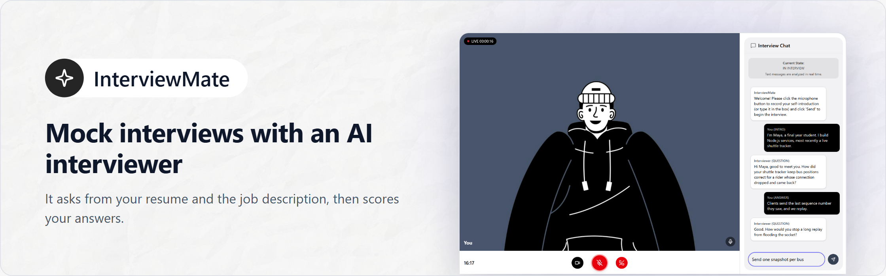
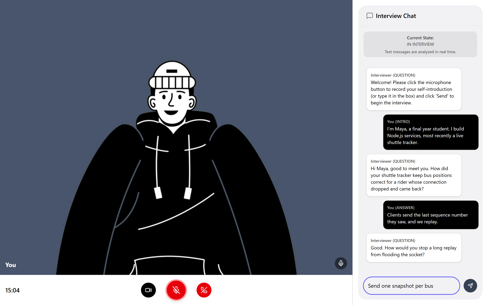
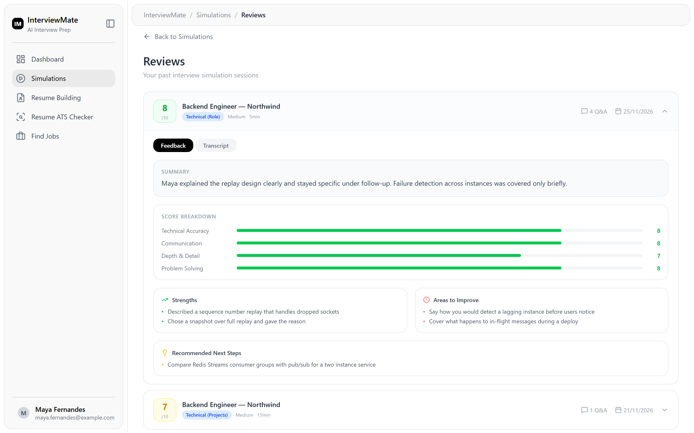
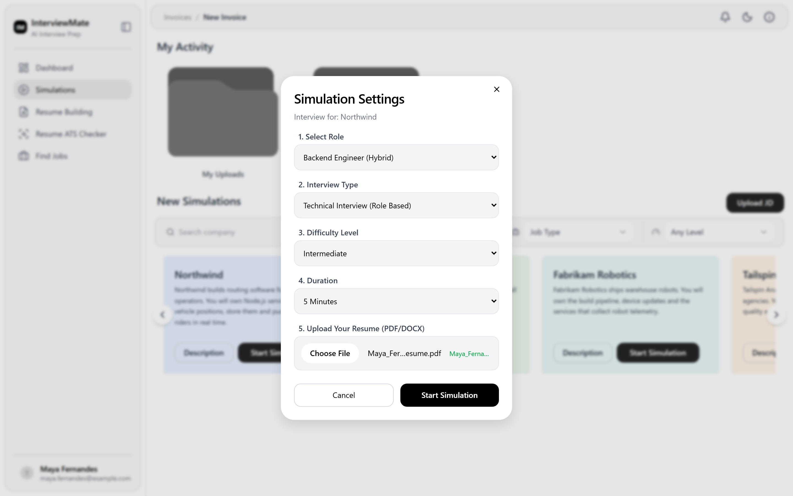
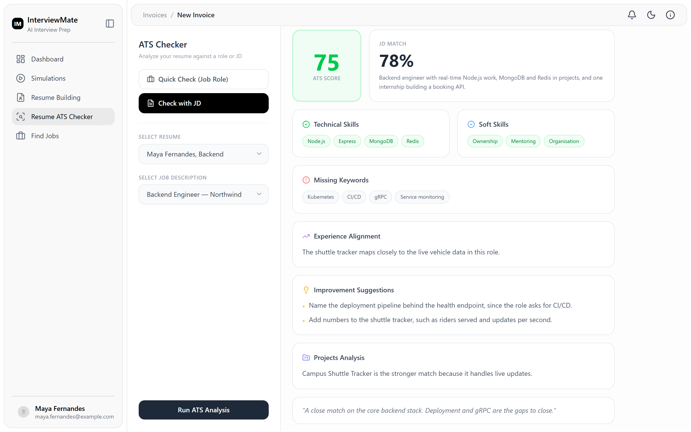
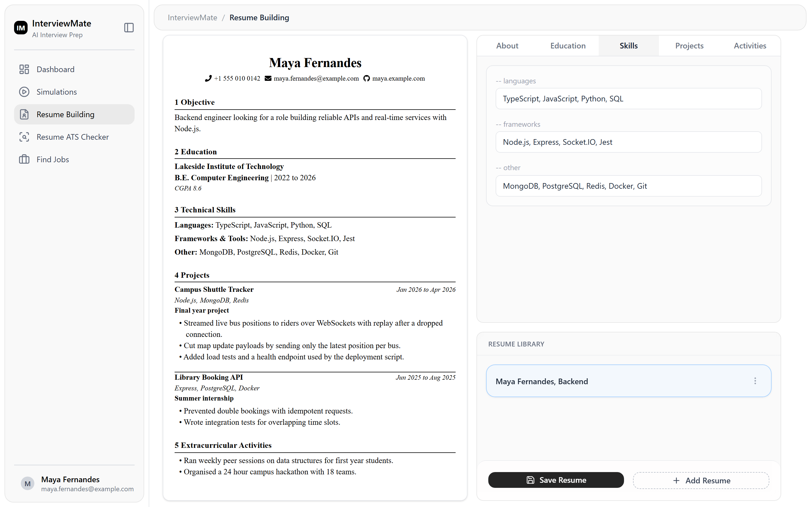
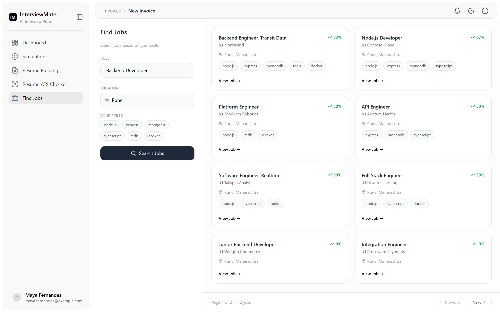
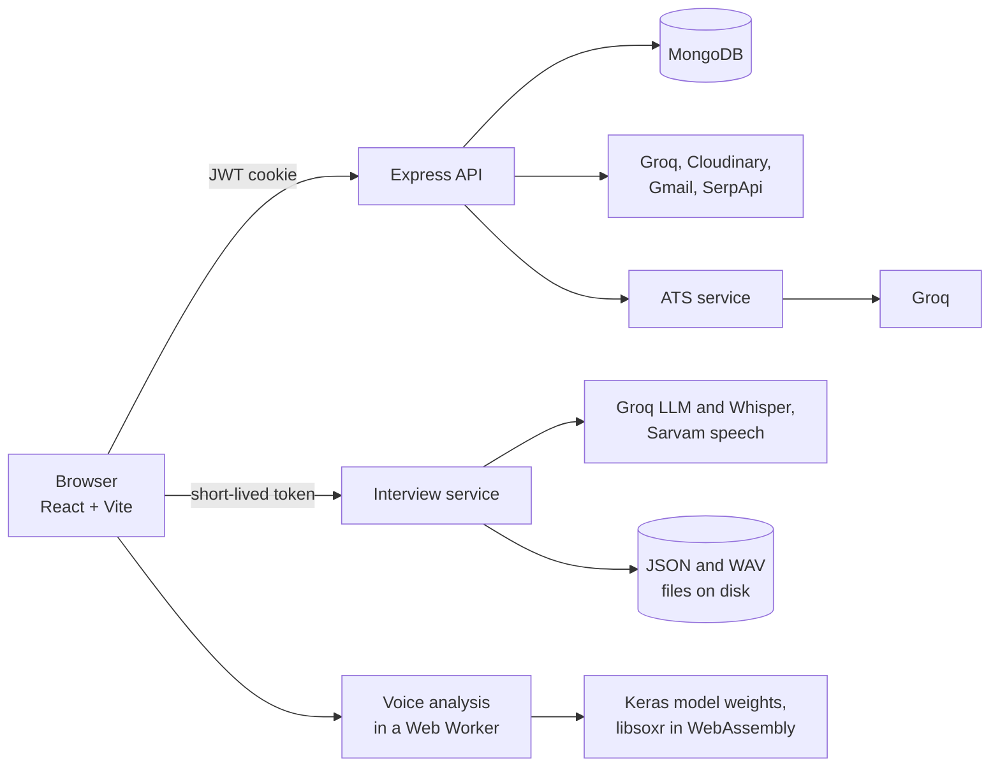
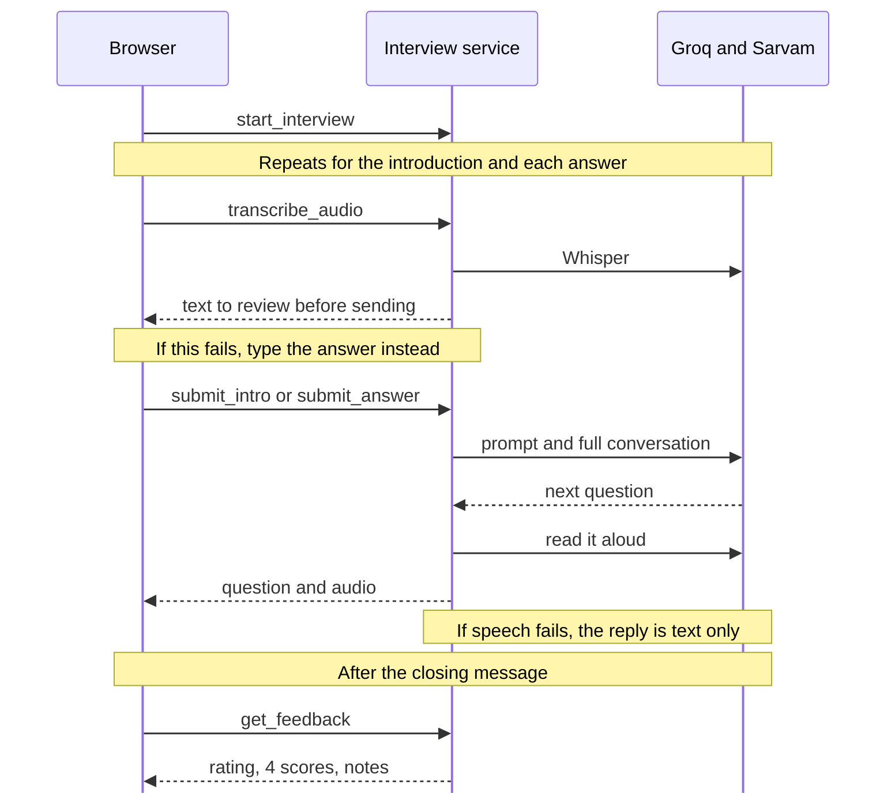

<p align="center">
  <picture>
    <source media="(prefers-color-scheme: dark)" srcset="docs/screenshots/banner-dark.png">
    
  </picture>
</p>

# InterviewMate

InterviewMate runs a mock interview with an AI interviewer that asks from your resume and a job description, then scores your answers.

[Live app](https://interviewmate.lekh.online) · [Screenshots](#screenshots) · [Features](#features) · [Architecture](#architecture) · [Tech stack](#tech-stack) · [Quick start](#quick-start) · [Documentation](#documentation) · [Honest limits](#honest-limits)

<!--
  Demo video goes here.
  GitHub does not play an .mp4 that is stored in the repository.
  Edit this file on github.com, drag the compressed video into the editor at this spot,
  and replace this comment with the https://github.com/user-attachments/assets/... link it inserts.
  Keep that link on its own line.
-->

## Screenshots

**The interview.** The camera view is your own. The interviewer writes in the chat and can speak.

<p></p>

**The review.** A rating, four scores, strengths, gaps and next steps, saved with the transcript.

<p></p>

| Set up an interview | Check a resume against a job |
|---|---|
|  |  |

| Edit a resume | Find jobs |
|---|---|
|  |  |

These were taken from the app running locally with fictional data and a drawing in place of the camera. Groq, Sarvam, Cloudinary and the job search were replaced by local stand-ins, so the written questions, feedback, report and jobs are samples. The ATS Score and job match percentages were calculated by the real code.

## Features

**Practice**

- Upload a job description and choose an interview type (HR, projects, role, DSA or hybrid), a difficulty, and 3 to 17 questions.
- Answer by voice or by typing. Recorded answers are transcribed for you to check before you send them.
- Hear each question read aloud.
- Get a rating out of 10, four scores and next steps, with a voice emotion reading of your recorded answers. Past interviews and transcripts are in **Reviews**.

**Prepare a resume**

- Turn a PDF or `.tex` resume into editable sections, with a report of what was read, or start from scratch.
- Edit on real A4 pages: reorder sections, drag the spacing, fit to one page, then download a PDF or LaTeX, or open it in Overleaf.
- Compare a resume with a job description or a role name for an ATS score, missing keywords and suggestions.

**Find work and track progress**

- Search LinkedIn jobs from the past week, sorted by how many of your skills they mention.
- See an interview calendar, Codeforces and LeetCode progress, and links to practice sites on the dashboard.

## Architecture

The browser talks to an Express API for accounts and saved data, and directly to the Python interview service during an interview, using a token from the API. A second Python service scores resumes and is called only by the API. The voice emotion reading is calculated in the browser.



One interview, with what happens when an outside service fails:



The browser then saves the transcript, feedback and averaged voice reading through the Express API. The [session states](docs/mock-interviews.md#session-states) and the [ATS analysis](docs/resume-and-ats.md#how-the-analysis-runs) have their own diagrams.

## Tech stack

| Part | Built with |
|---|---|
| Frontend | React 19, TypeScript 5.9, Vite 7, Tailwind CSS 4, shadcn/ui, React Router 7, Recharts 3, Framer Motion 12 |
| API | Express 5, Mongoose 8, JWT in an HTTP-only cookie, bcrypt, Multer 2, Nodemailer 10 |
| Interview service | Python 3.11, Flask, Groq (`qwen/qwen3.8-27b`, `whisper-large-v3-turbo`), Sarvam `bulbul:v3` |
| ATS service | Flask, pypdf, Groq (`openai/gpt-oss-120b`). Optional: sentence-transformers (`all-MiniLM-L6-v2`) and ChromaDB |
| Voice analysis | TypeScript in a Web Worker: the original Keras model's weights, librosa's MFCC and pitch steps, libsoxr compiled to WebAssembly. Tested against the old Python service with Vitest. |
| Storage | MongoDB, Cloudinary |
| Hosting | Vercel for the frontend, the API, the interview service and the ATS service. Optionally Docker Compose and Caddy on one server for the ATS service, or Render. |

## Quick start

You need **Node.js 20.19+ or 22.13++**, **Python 3.11**, a **MongoDB** server, and keys for **Groq** and **Cloudinary**. A **Sarvam** key adds the interviewer's voice. This runs accounts, resumes and mock interviews. For the Resume Analyzer, job search and email sign-up, see [Setup](docs/setup.md).

**1. Get the code.**

```bash
git clone https://github.com/LekhNayak/InterviewMate-AI_Mock_Interview_Platform.git interviewmate
cd interviewmate
```

**2. Install and copy the settings files.** The commands are the same in bash and PowerShell. `npm install` installs the frontend, the API and [Turborepo](https://turborepo.com), which runs them.

```bash
npm install
cp backend/exampleENV.txt backend/.env
cp "models/Interview api_service/exampleENV.txt" "models/Interview api_service/.env"
cp frontend/exampleENVLOCAL.txt frontend/.env.local
```

Open `backend/.env` and set `MONGO_URI` (for example `mongodb://127.0.0.1:27017/interviewmate`), `SECRET_KEY` (any long random string), `GROQ_API_KEY` and the three `CLOUDINARY_` values. In `models/Interview api_service/.env`, set `GROQ_API_KEY` and `SARVAM_API_KEY`.

**3. Set up the interview service and the demo account.** The first command makes the service a Python 3.11 environment and installs its packages.

```bash
npx turbo run setup --filter=interview-service
npm run seed:demo -w backend
```

**4. Start everything.** The API, the interview service and the frontend start together, each with its own output.

```bash
npm run dev:interview
```

**5. Open <http://localhost:8080>.** Choose **Sign In** and click the **Demo Account** box. Under **Simulations**, use **Upload JD** to add a job description, then **Start Simulation**.

If a step fails, see [Troubleshooting](docs/troubleshooting.md).

## Documentation

| Page | What is in it |
|---|---|
| [Setup](docs/setup.md) | Every service, environment variable and port |
| [Architecture](docs/architecture.md) | Services, data model, accounts, models in use |
| [API reference](docs/api.md) | All endpoints |
| [Mock interviews](docs/mock-interviews.md) | Using them, session states, failures |
| [Resumes and the Resume Analyzer](docs/resume-and-ats.md) | Parsing, scoring and the analysis flow |
| [Job search](docs/job-search.md) | How results are matched and paged |
| [Voice analysis](docs/voice-analysis.md) | How the voice reading runs in the browser and how it is tested |
| [Deployment](docs/deployment.md) | Vercel, Docker Compose on Oracle Cloud, Render |
| [Troubleshooting](docs/troubleshooting.md) | Common errors and fixes |

## Honest limits

- **Not security reviewed.** Do not upload anything confidential. The interview and ATS services check for a login only when `SERVICE_TOKEN_SECRET` is set.
- **Scores are estimates.** Feedback comes from a language model. The ATS score is calculated from requirement evidence, keywords and format checks, modelled on how applicant tracking systems screen, but it is not the result of any specific ATS. Neither has been measured for accuracy.
- **Voice emotion is experimental.** The model's accuracy has not been measured here, it reads only the first 2 seconds or so of each answer, and the reading does not affect your score. The browser version gives the same results as the old server, including the pitch value, which is half the real pitch; see [Voice analysis](docs/voice-analysis.md#known-limits).
- **Video is not recorded.** The camera is only a mirror for you.
- **Live sessions are files on one server.** The interview service does not scale past one process.
- **Desktop, light theme and PDF only.** Pages are laid out for desktop screens, and other resume formats are not parsed.
- **Automated tests cover only the voice analysis** (`npm test -w frontend`).

The browser resamples audio with libsoxr, which is licensed under the LGPL 2.1 or later. Its notice and license are in [frontend/public/licenses/soxr](frontend/public/licenses/soxr).

## Author

Built by [Lekh Nayak](https://github.com/LekhNayak). See [all contributors](https://github.com/LekhNayak/InterviewMate-AI_Mock_Interview_Platform/graphs/contributors).
