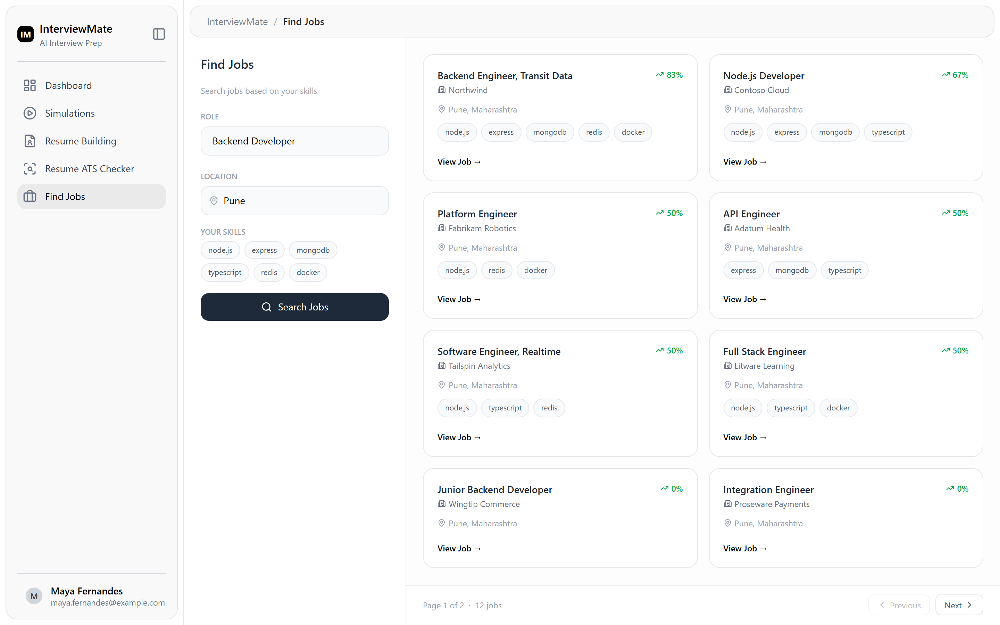

# Job search

Open **Find Jobs**, type a role, optionally a location, and choose **Search Jobs**.

## How results are found

1. The API adds the skills from your profile to the role and searches LinkedIn jobs from the past week through the Fresh LinkedIn Scraper API on RapidAPI.
2. Each job gets a match score: the share of your profile skills that appear as whole words in its description. With no skills on your profile, every score is 0.
3. Results are sorted by score.
4. If you gave a location, jobs whose location text does not contain it are dropped. The search API does not apply location strictly, so this is done after the results arrive.

Skills come from your profile on the **Dashboard**. Sign-up fills them from your resume, and the pencil button on the profile card edits them.

## Paging

The page shows 8 jobs at a time. **Next** moves through the results already loaded, and on the last page it asks the API for another batch and adds it to the list.

The location filter can empty a batch while later ones still have matches, so the page reads up to 3 batches at a time before it reports that nothing was found.

## Notes

- It needs `RAPIDAPI_KEY` in `backend/.env`.
- Each batch is one call against your RapidAPI quota.
- Searches are not saved.

The endpoint is in the [API reference](api.md#jobs).
