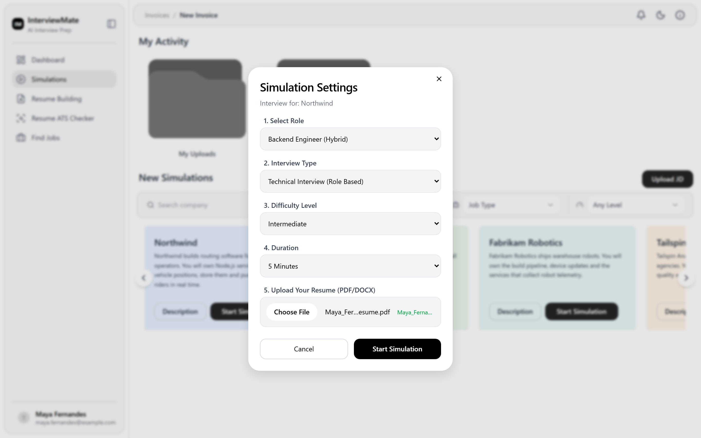
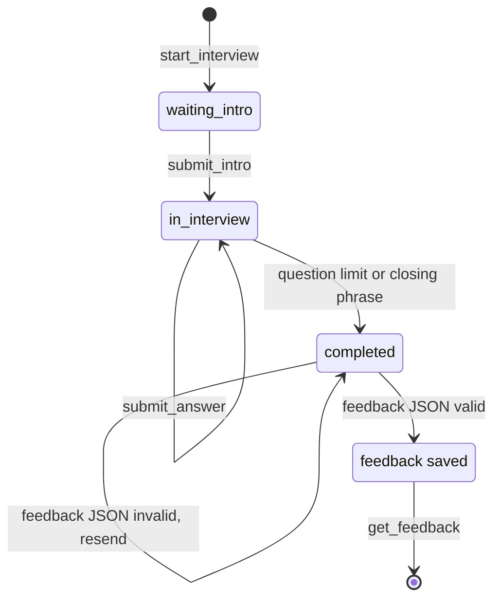

# Mock interviews

## Start one

1. Open **Simulations** and choose **Upload JD** to add a job description as a PDF. Each company then gets a card.
2. Choose **Start Simulation** on a card. From **My Uploads** the same button is called **Simulate**.
3. Pick the role, interview type, difficulty and duration, and choose your resume. Use a PDF. The dialog also offers DOCX, but the parser only reads PDF.
4. Choose **Start Simulation**. The resume is parsed and saved to your resume library, then the interview page opens.
5. Allow the camera and microphone, then choose **Start AI Interview**.

| Setting | Options |
|---|---|
| Interview Type | HR Interview, Technical Interview (Projects Based), Technical Interview (Role Based), DSA Interview, Hybrid (DSA + Technical) |
| Difficulty Level | Beginner, Intermediate, Expert |
| Duration | 5, 10, 15, 30 or 45 minutes |

Duration sets the number of questions. There is no timer that ends the interview.

| Duration | Questions |
|---|---|
| 5 minutes | 3 |
| 10 minutes | 5 |
| 15 minutes | 8 |
| 30 minutes | 12 |
| 45 minutes | 17 |

## Answer

Click the red microphone button to record and click it again to stop. The text appears in the box so you can correct it before you send it. You can also type.

The first message is your introduction. After that the interviewer asks one question at a time, using your resume, the job description, the type and level you chose, and everything said so far. If Sarvam is configured, each reply is read aloud.

## Feedback

When the interviewer closes the interview, choose **Get Feedback**, then **View Feedback**. You get a rating out of 10, a summary, strengths, areas to improve and next steps. **Get Feedback** also saves the interview.

Saved interviews are under **Simulations**, in the **Reviews** folder. Reviews also shows four scores (technical accuracy, communication, depth, problem solving) and the transcript.

If you leave the page before choosing **Get Feedback**, the interview does not appear in Reviews.

## Session states

The interview service keeps each session in `data/interview_sessions.json`.

The service ends the interview when the question limit is reached, or earlier if a reply contains "thank you", "conclude", "that's a wrap", "best of luck" or "pleasure speaking".

## What happens when something fails

| Failure | Result |
|---|---|
| Camera or microphone refused | An **Enable Media** screen. The interview cannot start. |
| Transcription fails | A message in the chat. Type the answer instead. |
| Emotion service down | Nothing visible. Its result is not used. |
| Sarvam fails or has no key | The reply arrives as text without audio. |
| Groq fails on a question | The error is shown in the chat. Send the answer again. |
| Feedback is cut off or is not JSON | The last answer returns an error. Send another message to try again. |

## Known problems

- A question that contains "thank you" ends the interview early.
- Feedback is not fetched on its own. Use the **Get Feedback** button.
- For recorded answers, the saved transcript shows "Transcription received..." in place of the question. Typed answers are saved correctly.
- Feedback is limited to 350 tokens, so a long one can be cut off and fail to parse.
- The LIVE timer is drawn behind the video and cannot be seen.

The API for this service is in [API reference](api.md#interview-service).
