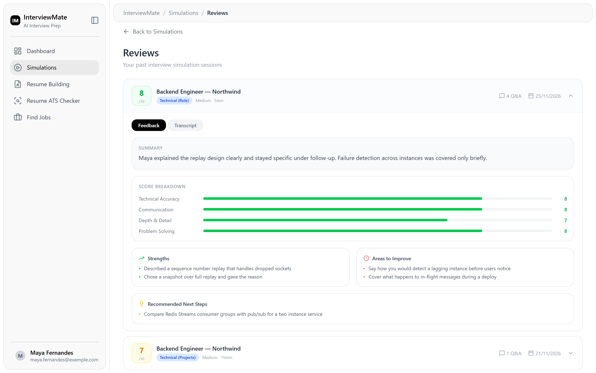
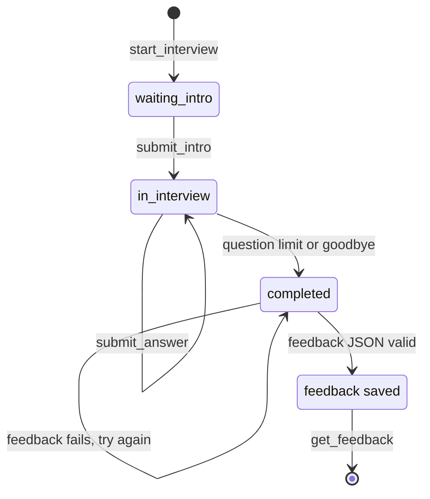

# Mock interviews

## Start one

1. Open **Simulations** and choose **Upload JD** to add a job description as a PDF. Each company then gets a card.
2. Choose **Start Simulation** on a card. From **My Uploads** the same button is called **Simulate**.
3. Pick the role, interview type, difficulty and duration, and choose your resume as a PDF. The work mode filter above the cards narrows them to Remote, Hybrid or On-site roles.
4. Choose **Start Simulation**. The resume is parsed and saved to your resume library, then the interview page opens.
5. Allow the camera and microphone, then choose **Start AI Interview**.

| Setting | Options |
|---|---|
| Interview Type | HR Interview, Technical Interview (Projects Based), Technical Interview (Role Based), DSA Interview, Hybrid (DSA + Technical) |
| Difficulty Level | Beginner, Intermediate, Expert |
| Duration | 5, 10, 15, 30 or 45 minutes |

Duration sets the number of questions. There is no timer that ends the interview.

| Duration | Questions |
|---|---|
| 5 minutes | 3 |
| 10 minutes | 5 |
| 15 minutes | 8 |
| 30 minutes | 12 |
| 45 minutes | 17 |

## Answer

Click the red microphone button to record and click it again to stop. The text appears in the box so you can correct it before you send it. You can also type.

The first message is your introduction. After that the interviewer asks one question at a time, using your resume, the job description, the type and level you chose, and everything said so far. If Sarvam is configured, each reply is read aloud.

## Feedback

When the interviewer closes the interview, the feedback is fetched and saved. Choose **View Feedback** for a rating out of 10, a summary, strengths, areas to improve and next steps. If fetching it fails, **Get Feedback** tries again.

If you recorded answers, the feedback also shows your speaking style and emotions, averaged over those answers. Your browser calculates them while the interview goes on, so the recordings are not sent anywhere for this. It does not change your score. See [Voice analysis](voice-analysis.md).

Saved interviews are under **Simulations**, in the **Reviews** folder. Reviews also shows four scores (technical accuracy, communication, depth, problem solving), the voice reading and the transcript.

If you leave the page before the feedback arrives, the interview does not appear in Reviews.

## Session states

The interview service keeps each session in MongoDB, in the `interview_sessions` collection, for 7 days.

The service ends the interview when the question limit is reached. It also ends it earlier if a reply asks nothing and says goodbye, with a phrase such as "best of luck" or "thank you for your time".

## What happens when something fails

| Failure | Result |
|---|---|
| Camera or microphone refused | An **Enable Media** screen. The interview cannot start. |
| Transcription fails | A message in the chat. Type the answer instead. |
| The browser cannot decode a recording, or the voice analysis files do not load | That answer has no voice reading. With none, the feedback has no voice section. |
| Sarvam fails or has no key | The reply arrives as text without audio. |
| Groq fails on a question | The error is shown in the chat and your answer goes back into the box. Send it again. |
| Feedback is cut off or is not JSON | The service asks the model once more. If that fails too, use **Get Feedback**. |
| Saving to Reviews fails | A message says so. The feedback stays on the page. |

The API for this service is in [API reference](api.md#interview-service).
