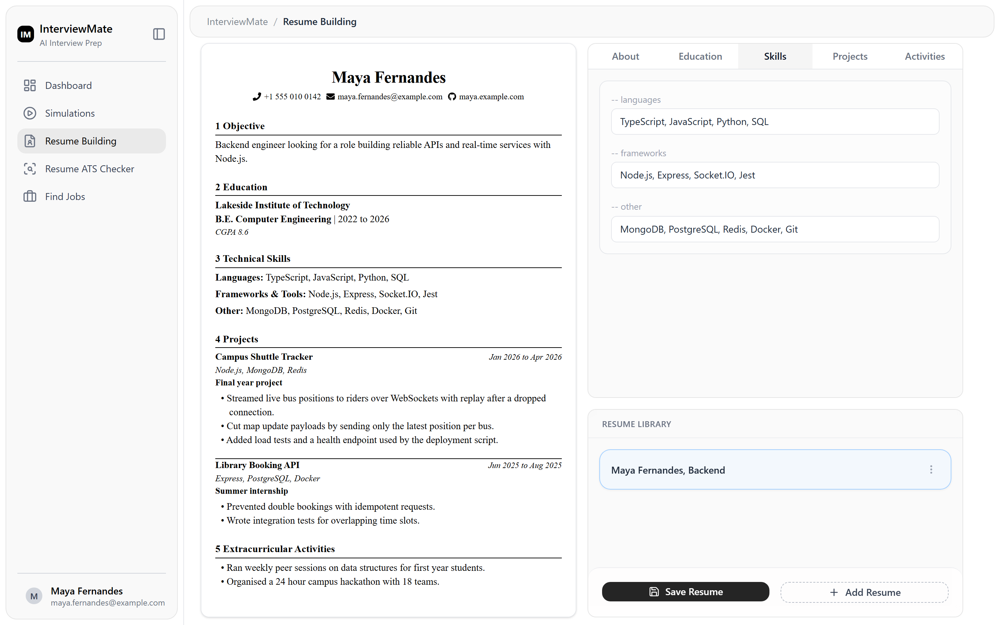
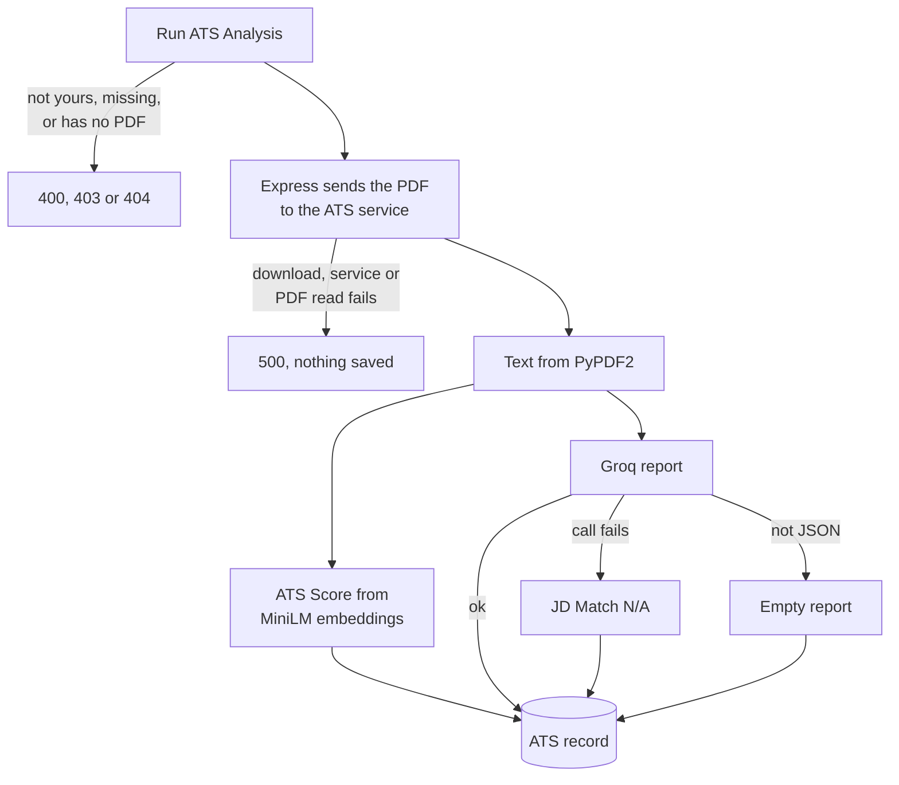

# Resumes and the ATS Checker

## Build and edit resumes

**Resume Building** has the resume on A4 pages, an editor and your resume library.

A resume is your name and contact details, then sections in the order you choose. A section is a paragraph (summary), dated entries (experience, education, projects, anything similar), skill groups, or a list (certifications, awards, activities).

- **Upload PDF or .tex** reads a file into sections and shows what it found. **New resume** starts with empty Summary, Experience, Education, Projects and Skills sections.
- In the editor, open a section to change its heading and contents. Drag the handle or use the arrows to reorder sections and entries, the eye to leave a section out of the PDF, and **Add section** for more. In a bullet, Enter adds the next bullet.
- Click a section on the pages to open it in the editor.
- **Save**, or Ctrl+S, stores the open resume. A dot in the library marks unsaved changes.
- The menu on each resume has **Rename**, **Duplicate**, **Import report** and **Delete**. **Duplicate** saves a copy, for example to tailor one for each job.

### Pages and spacing

The preview is what prints: A4 pages, and a page number when there is more than one. A heading is never left at the bottom of a page, and an entry's title moves to the next page with its first bullet.

- Drag the gap between two sections, or two entries, to change that spacing everywhere. A gap can also be focused with Tab and changed with the arrow keys.
- **Layout** sets the font size, line spacing, margins and both gaps. **Fit to one page** tightens them a step at a time, gaps first and font size last, until the resume fits.
- These settings are saved with each resume.

**PDF** opens the browser's print dialog with only the resume in it. Choose **Save as PDF**. The PDF has selectable text and the same pages as the preview.

**LaTeX** downloads a `.tex` file with the same sections, order and spacing, or opens it as a new project on Overleaf (a free account is needed). It builds with pdfLaTeX and standard packages. Emoji are left out of it.

### How uploads are read

1. A PDF's text is extracted with `pdf-parse`. A `.tex` file is read as source, without its comments and package setup.
2. Groq returns the header and every section, in the file's order and with its headings. A strict JSON schema fixes the shape of the answer.
3. Each line of the file is compared with the result. A line counts as captured when most of its words are in the resume.
4. The resume is saved under your account, and the PDF is stored for the ATS Checker. The server sets the owner, the PDF link and the report itself.

The report after an upload lists each section with what it became and how many entries it has, the share of lines captured, any lines that were not, and, for a `.tex` file, headings with no section. **Discard import** deletes the resume. The report stays available from the library menu.

PDF and `.tex` files are accepted, up to 4 MB. A scanned PDF is an image and cannot be read.

## Check a resume against a job

**Resume ATS Checker** has two modes:

| Mode | Compares your resume with |
|---|---|
| Quick Check (Job Role) | A short generic description of the role you type |
| Check with JD | A job description you uploaded |

The resume must have been uploaded as a PDF, because the analysis reads the original file. Edits made in the app and resumes made from scratch are not included.

Choose a resume, fill in the role or JD, and choose **Run ATS Analysis**. You get two separate numbers:

- **ATS Score** comes from text similarity. Both texts are embedded with `all-MiniLM-L6-v2`, and the cosine similarity is multiplied by 150 and capped at 99. It measures topic overlap and is not a pass mark used by any real ATS.
- **JD Match** is a percentage estimated by the language model. It comes with matched skills, missing keywords, experience alignment, suggestions, a projects analysis and a short verdict.

## How the analysis runs

The PDF download times out after 20 seconds and the ATS call after 60 seconds. The first call is slow because the embedding model loads on first use.

The ATS service can also return the three most similar resumes from its ChromaDB index, if `include_similar` is sent. The app does not ask for them, because they quote other people's resumes.

Endpoints are in the [API reference](api.md#ats).
