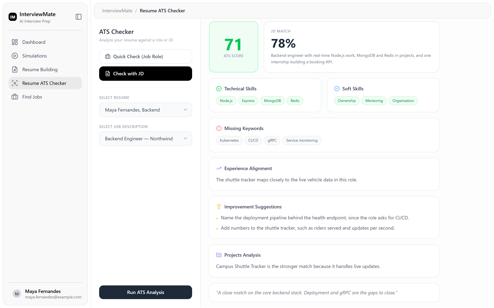
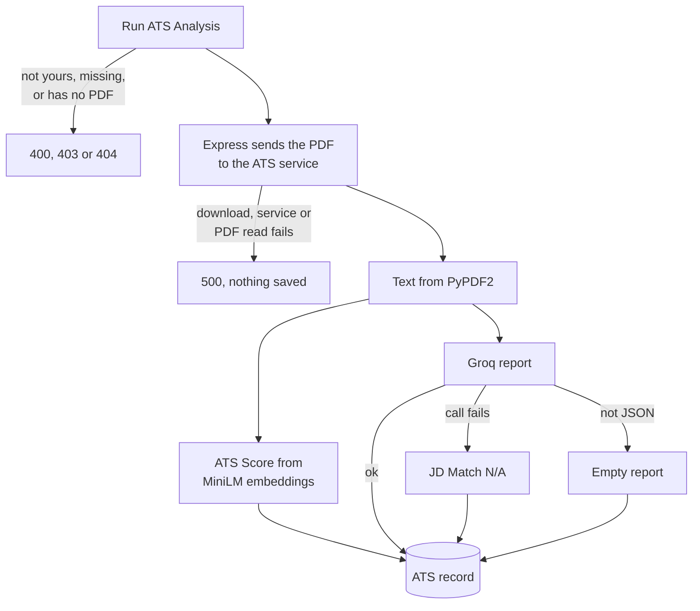

# Resumes and the ATS Checker

## Build and edit resumes

**Resume Building** has a preview, a tabbed editor (About, Education, Skills, Projects, Activities) and your resume library.

- **Add Resume**, then **Upload PDF**, parses a PDF into fields. **Create from Scratch** adds an empty resume.
- **Save Resume** stores your edits.
- The menu on each resume has **Rename**, **Download PDF**, **Download LaTeX** and **Delete**.

The PDF has selectable text. It uses a standard PDF font, so characters outside Western European alphabets may not print.

### How parsing works

1. The PDF is uploaded to Cloudinary.
2. `pdf-parse` extracts the text, which is cut at 16,000 characters.
3. Groq returns JSON for the header, objective, education, skills, projects and activities.
4. The resume is saved under your account. The server sets the owner and the PDF link itself and ignores any sent by the client.

Only PDF files are accepted, up to 10 MB.

## Check a resume against a job

**Resume ATS Checker** has two modes:

| Mode | Compares your resume with |
|---|---|
| Quick Check (Job Role) | A short generic description of the role you type |
| Check with JD | A job description you uploaded |

The resume must have been uploaded as a PDF, because the analysis reads the original file. Edits made in the app and resumes made from scratch are not included.

Choose a resume, fill in the role or JD, and choose **Run ATS Analysis**. You get two separate numbers:

- **ATS Score** comes from text similarity. Both texts are embedded with `all-MiniLM-L6-v2`, and the cosine similarity is multiplied by 150 and capped at 99. It measures topic overlap and is not a pass mark used by any real ATS.
- **JD Match** is a percentage estimated by the language model. It comes with matched skills, missing keywords, experience alignment, suggestions, a projects analysis and a short verdict.

## How the analysis runs

The PDF download times out after 20 seconds and the ATS call after 60 seconds. The first call is slow because the embedding model loads on first use.

The ATS service can also return the three most similar resumes from its ChromaDB index, if `include_similar` is sent. The app does not ask for them, because they quote other people's resumes.

Endpoints are in the [API reference](api.md#ats).
