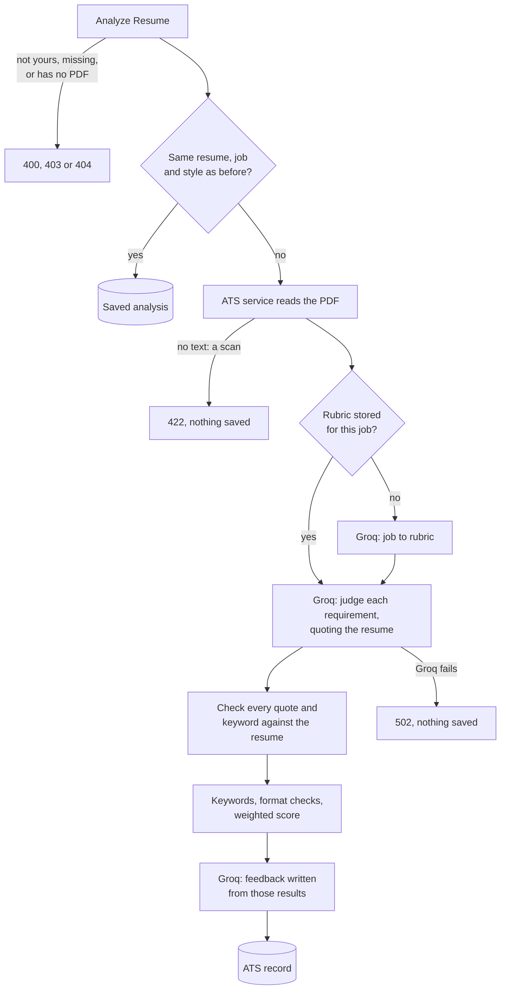

# Resumes and the Resume Analyzer

## Build and edit resumes

**Resume Building** has the resume on A4 pages, an editor and your resume library.

A resume is your name and contact details, then sections in the order you choose. A section is a paragraph (summary), dated entries (experience, education, projects, anything similar), skill groups, or a list (certifications, awards, activities).

- **Upload PDF or .tex** reads a file into sections and shows what it found. **New resume** starts with empty Summary, Experience, Education, Projects and Skills sections.
- In the editor, open a section to change its heading and contents. Drag the handle or use the arrows to reorder sections and entries, the eye to leave a section out of the PDF, and **Add section** for more. In a bullet, Enter adds the next bullet.
- Click a section on the pages to open it in the editor.
- **Save**, or Ctrl+S, stores the open resume. A dot in the library marks unsaved changes.
- The menu on each resume has **Rename**, **Duplicate**, **Import report** and **Delete**. **Duplicate** saves a copy, for example to tailor one for each job.

### Pages and spacing

The preview is what prints: A4 pages, and a page number when there is more than one. A heading is never left at the bottom of a page, and an entry's title moves to the next page with its first bullet.

- Drag the gap between two sections, or two entries, to change that spacing everywhere. A gap can also be focused with Tab and changed with the arrow keys.
- **Layout** sets the font size, line spacing, margins and both gaps. **Fit to one page** tightens them a step at a time, gaps first and font size last, until the resume fits.
- These settings are saved with each resume.

**PDF** opens the browser's print dialog with only the resume in it. Choose **Save as PDF**. The PDF has selectable text and the same pages as the preview.

**LaTeX** downloads a `.tex` file with the same sections, order and spacing, or opens it as a new project on Overleaf (a free account is needed). It builds with pdfLaTeX and standard packages. Emoji are left out of it.

### How uploads are read

1. A PDF's text is extracted with `pdf-parse`. A `.tex` file is read as source, without its comments and package setup.
2. Groq returns the header and every section, in the file's order and with its headings. A strict JSON schema fixes the shape of the answer.
3. Each line of the file is compared with the result. A line counts as captured when most of its words are in the resume.
4. The resume is saved under your account, and the PDF is stored for the Resume Analyzer. The server sets the owner, the PDF link and the report itself.

The report after an upload lists each section with what it became and how many entries it has, the share of lines captured, any lines that were not, and, for a `.tex` file, headings with no section. **Discard import** deletes the resume. The report stays available from the library menu.

PDF and `.tex` files are accepted, up to 4 MB. A scanned PDF is an image and cannot be read.

## Check a resume against a job

**Resume Analyzer** has two modes:

| Mode | Compares your resume with |
|---|---|
| Quick Check (Job Role) | The requirements a typical posting for the role you type would list. Works for any profession. |
| Check with JD | A job description you uploaded. The text of its original PDF is used when it can be read, because it keeps the posting's own required and preferred sections. |

The resume must have been uploaded as a PDF, because the analysis reads the original file the way an applicant tracking system would. Edits made in the app and resumes made from scratch are not included.

Choose a resume, the role or JD and, optionally, a scoring style, then choose **Analyze Resume**. It takes about 10 seconds.

### What the score means

The score out of 100 is calculated by code from evidence. The language model never sets it.

| Part | What it measures |
|---|---|
| Required qualifications | Share of the job's required skills, tools and knowledge the resume shows. Met counts fully, partly counts half. |
| Preferred qualifications | The same for nice-to-have items |
| Experience | Relevant years against the job's minimum, and experience requirements |
| Responsibilities | Whether the resume shows the duties the job describes |
| Education and certifications | Degrees, licences and certifications the job asks for |
| Keyword match | The job's terms written in the resume, as keyword filters look for them, with synonyms. A requirement shown in other words counts 75%. |
| ATS readability | 12 format checks: readable text, no icon fonts, contact details, standard headings, length, bullets, measurable results, action verbs, weak phrases, first person and dates |
| Semantic similarity | Only with the optional embedding engine (see below) |

A part the job does not ask for is left out, and the other weights are scaled up. 80 and above is a strong match, 65 a good one, 50 a partial one.

A missing **must-have** requirement, such as a licence, a required degree or a minimum number of years, caps the score at 45, because most ATS screen those out first. For years of experience this applies only below half the years asked for.

Every requirement comes with a quote from the resume as evidence. The service checks that each quote really is in the resume. A match the resume does not support is downgraded and marked **Unverified**.

### Scoring styles

| Style | Weighs most |
|---|---|
| Auto | Entry level for intern and entry-level jobs, Experienced hire for senior and lead jobs, Balanced otherwise |
| Balanced | Required qualifications, then experience, keywords and responsibilities |
| Classic ATS | Keyword match, like older keyword-filter ATS |
| Skills first | Required and preferred qualifications |
| Experienced hire | Experience and responsibilities |
| Entry level | Qualifications and education; years count little |

`ATS_WEIGHTS` in the ATS service's `.env` overrides any weight for every analysis.

### The same input gives the same result

The first analysis of a job turns it into a rubric of requirements, which the API stores in the `atsrubrics` collection. Every later analysis of that job or role is judged against the same rubric. Editing the JD builds a new one.

Running the same resume PDF against the same job with the same scoring style again returns the saved analysis instead of a new one.

## How the analysis runs

If only the feedback step fails, the score, evidence and checks are still saved, without the written feedback.

The engine is in `models/Resume ATS and JD/api_service/ats_core/`. It needs no PyTorch, so it runs on Vercel.

### Optional embedding engine

The `semantic/` folder holds the earlier embedding scoring (`all-MiniLM-L6-v2`) and the ChromaDB resume bank. It needs PyTorch, which is too large for Vercel, so it is off unless `ATS_SEMANTIC=1` is set and `requirements-semantic.txt` is installed. The Dockerfile does both. It then adds the **Semantic similarity** part to the score, and `include_similar=true` returns the three closest resumes from the bank. The app does not ask for those, because they quote other people's resumes. See [semantic/README.md](../models/Resume%20ATS%20and%20JD/api_service/semantic/README.md).

Endpoints are in the [API reference](api.md#ats).
