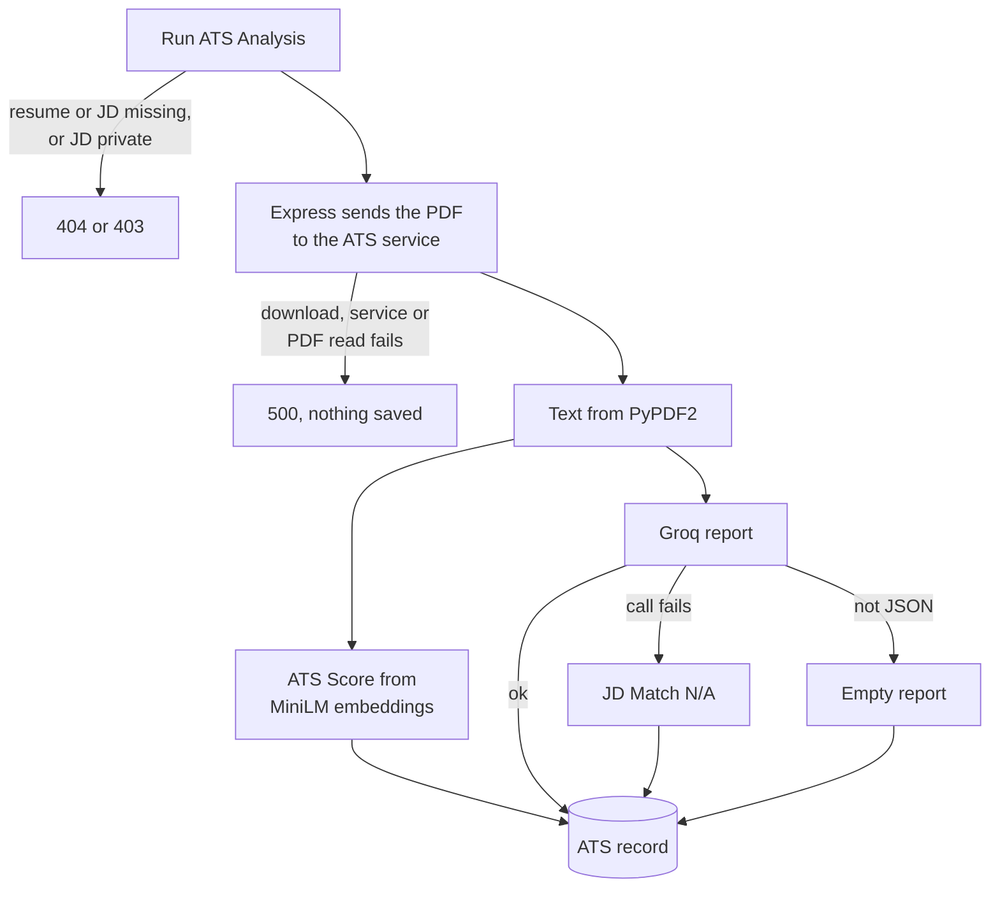

# Resumes and the ATS Checker

## Build and edit resumes

**Resume Building** has a preview, a tabbed editor (About, Education, Skills, Projects, Activities) and your resume library.

- **Add Resume**, then **Upload PDF**, parses a PDF into fields. **Create from Scratch** adds an empty resume.
- **Save Resume** stores your edits.
- The menu on each resume has **Rename**, **Download PDF** and **Delete**.

**Download PDF** downloads a LaTeX `.tex` file, not a PDF. Compile it with a LaTeX tool to get a PDF.

### How parsing works

1. The PDF is uploaded to Cloudinary.
2. `pdf-parse` extracts the text, which is cut at 16,000 characters.
3. Groq returns JSON for the header, objective, education, skills, projects and activities.
4. The resume is saved under your account. The server sets the owner from the login cookie and ignores any owner sent when a resume is created.

A name, phone number and email are required. If the PDF does not contain them, the upload fails.

## Check a resume against a job

**Resume ATS Checker** has two modes:

| Mode | Compares your resume with |
|---|---|
| Quick Check (Job Role) | A short generic description of the role you type |
| Check with JD | A job description you uploaded |

Choose a resume, fill in the role or JD, and choose **Run ATS Analysis**. You get two separate numbers:

- **ATS Score** comes from text similarity. Both texts are embedded with `all-MiniLM-L6-v2`, and the cosine similarity is multiplied by 150 and capped at 99. It measures topic overlap and is not a pass mark used by any real ATS.
- **JD Match** is a percentage estimated by the language model. It comes with matched skills, missing keywords, experience alignment, suggestions, a projects analysis and a short verdict.

## How the analysis runs

The PDF download times out after 20 seconds and the ATS call after 60 seconds. The first call is slow because the embedding model loads on first use.

The service also returns the three most similar resumes from its ChromaDB index. They are saved with the record but the app does not show them.

## Known problems

- Quick Check does not save the projects analysis.
- The job text sent for analysis contains "Experience Level: undefined", because that field is not in the schema.
- **Save Resume** fails on a resume you have just uploaded, because the page gives it a temporary id. The upload itself is saved, so reload the page before you edit it.
- A resume made with **Create from Scratch** cannot be saved. It gets a temporary id too, and the server requires a PDF URL.

Endpoints are in the [API reference](api.md#ats).
